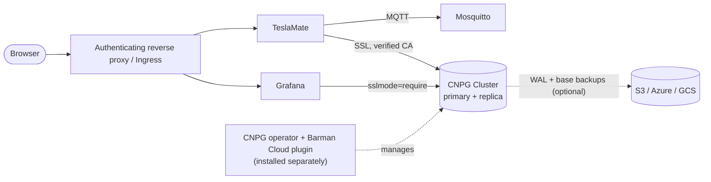

# teslamate

  
[](LICENSE)
[](https://artifacthub.io/packages/search?repo=dcardozoo)
[](https://github.com/dcardozoo/teslamate-helm-chart/actions/workflows/lint-test.yaml)

TeslaMate data logger with Grafana dashboards, Mosquitto MQTT broker and a highly available CloudNativePG PostgreSQL cluster. Requires the CloudNativePG operator (and the Barman Cloud plugin for backups) to be installed separately.

> This chart is an independent community project and is not affiliated with Tesla, Inc. or the TeslaMate project.

**Homepage:** <https://github.com/teslamate-org/teslamate>

## Overview

This chart deploys [TeslaMate](https://github.com/teslamate-org/teslamate) (a self-hosted Tesla data logger) with:

- TeslaMate (single replica, `Recreate` strategy)
- Grafana with the TeslaMate dashboards preinstalled (`teslamate/grafana` image)
- Eclipse Mosquitto as MQTT broker
- a highly available PostgreSQL `Cluster` managed by [CloudNativePG](https://cloudnative-pg.io) (CNPG), with optional scheduled backups through the [Barman Cloud plugin](https://cloudnative-pg.io/plugin-barman-cloud/)

By default the database uses the **CNPG operator** (and, for backups, the **Barman Cloud plugin**). This chart does **not** install either of them, see [Prerequisites](#prerequisites). Every component is optional, so you can also use an existing PostgreSQL server or MQTT broker.



## Prerequisites

- Kubernetes >= 1.29
- Helm >= 3.14 (Helm 4 works)
- A default StorageClass (or set `storageClass` per component)
- With `database.type: cnpg` (default): the [CloudNativePG operator](https://cloudnative-pg.io/docs/current/installation_upgrade/), installed once per cluster
- For backups only: the [Barman Cloud plugin](https://cloudnative-pg.io/plugin-barman-cloud/docs/installation/), installed in the operator's namespace (it requires cert-manager)

Example installation of the operator with its official Helm chart:

```sh
helm repo add cnpg https://cloudnative-pg.github.io/charts
helm upgrade --install cnpg cnpg/cloudnative-pg -n cnpg-system --create-namespace --wait
```

Follow the linked documentation for the plugin and for production setups.

## Quick start

```sh
helm install teslamate oci://ghcr.io/dcardozoo/charts/teslamate \
  -n teslamate --create-namespace \
  --set teslamate.encryptionKey=$(openssl rand -base64 32) \
  --wait
```

`teslamate.encryptionKey` (or `teslamate.existingSecret`) is **required**; the install fails without it. The key encrypts your Tesla API tokens in the database. Store it somewhere safe: if it is lost or changed, the stored tokens become unreadable and you have to sign in to Tesla again. For repeatable installs, put the key in a Secret and use `teslamate.existingSecret` (key name `ENCRYPTION_KEY`, configurable via `teslamate.existingSecretKey`).

On the first install the pods stay in `CreateContainerConfigError` for 1-2 minutes until CNPG has created its secrets. This is expected.

Then open the UIs (no Ingress by default):

```sh
kubectl -n teslamate port-forward svc/teslamate 4000:4000
kubectl -n teslamate port-forward svc/teslamate-grafana 3000:3000
```

Resource names use `<fullname>`, which is the release name (`<release>-teslamate` when the release name does not contain "teslamate"). The examples assume a release named `teslamate`.

Grafana starts with `admin` / `admin` and asks for a new password on first login, unless you set `grafana.existingAdminSecret` (a Secret with keys `admin-user` and `admin-password`).

Verify the installation:

```sh
helm test teslamate -n teslamate --logs
```

Coming from the upstream docker-compose setup? See [docs/migrating-from-docker-compose.md](docs/migrating-from-docker-compose.md) to move your existing data.

## Configuration scenarios

Pass these with `-f values.yaml`. Each one also needs `teslamate.encryptionKey` or `teslamate.existingSecret`.

### Full stack (default)

TeslaMate, Grafana, Mosquitto and a 2-instance PostgreSQL 18 CNPG cluster. No values needed besides the key.

### TeslaMate and database only

```yaml
teslamate:
  mqtt:
    enabled: false
grafana:
  enabled: false
mosquitto:
  enabled: false
```

### External PostgreSQL

The database user needs the privileges TeslaMate's migrations require, see [docs/database.md](docs/database.md). The chart does not manage SUPERUSER for external databases.

```yaml
database:
  type: external
  external:
    host: postgres.example.com
    port: 5432
    database: teslamate
    username: teslamate
    existingSecret: teslamate-db      # key "password" by default
    ssl: "true"                       # false | true | noverify
```

No CNPG operator is needed in this case.

### External MQTT broker

```yaml
mosquitto:
  enabled: false
teslamate:
  mqtt:
    host: mqtt.example.com
    port: 1883
    existingSecret: mqtt-credentials   # keys: username, password
    tls: false
```

### Ingress

```yaml
teslamate:
  ingress:
    enabled: true
    className: nginx
    hosts:
      - host: teslamate.example.com
        paths: [{path: /, pathType: Prefix}]
```

TeslaMate has no authentication. See [Security](#security).

With an Ingress (or `teslamate.virtualHost`), the chart sets `VIRTUAL_HOST` to that host and `CHECK_ORIGIN=true`, so TeslaMate's websocket only accepts connections from that origin. Accessing the UI under another name, e.g. through `kubectl port-forward`, then fails with a constantly reconnecting page. Allow extra origins with `teslamate.checkOrigin: "https://teslamate.example.com,//localhost:4000"`, or disable the check with `"false"`. See the [TeslaMate environment variables](https://docs.teslamate.org/docs/configuration/environment_variables).

## Database and SUPERUSER

**The TeslaMate database owner (`teslamate`) is a PostgreSQL SUPERUSER.** TeslaMate's migrations need it: they create the `earthdistance` extension, which PostgreSQL does not allow for regular users, and future migrations may need more. The upstream docker-compose setup does the same (`POSTGRES_USER=teslamate` makes it the superuser). The chart declares the role through CNPG `managed.roles`.

**Because of this, use this database only for TeslaMate. Do not host other applications' databases in it.**

Because Grafana editors can run arbitrary SQL through the datasource, also set `grafana.readOnlyUser`: a dedicated role with `pg_read_all_data` that Grafana uses instead of the owner. Create a `kubernetes.io/basic-auth` Secret first:

```sh
kubectl -n teslamate create secret generic grafana-db --type=kubernetes.io/basic-auth \
  --from-literal=username=grafana --from-literal=password=$(openssl rand -base64 24)
```

```yaml
grafana:
  readOnlyUser:
    enabled: true
    existingSecret: grafana-db
```

TeslaMate connects with `DATABASE_SSL=true` and verifies the CNPG CA; Grafana uses `sslmode=require`. The default cluster has 2 instances (the schema enforces a minimum of 2), PostgreSQL 18, data checksums and preferred pod anti-affinity. Details: [docs/database.md](docs/database.md).

## Backups

**Backups and restores are your responsibility.** The chart can configure WAL archiving and scheduled base backups through the Barman Cloud plugin, but it neither installs the plugin nor tests or manages the backup and restore process.

```yaml
database:
  cnpg:
    backup:
      enabled: true
      schedule: "0 0 3 * * *"     # six fields, seconds first
      retentionPolicy: 30d
      objectStore:
        destinationPath: s3://my-bucket/teslamate/
        s3Credentials:
          accessKeyId: {name: s3-credentials, key: ACCESS_KEY_ID}
          secretAccessKey: {name: s3-credentials, key: ACCESS_SECRET_KEY}
```

How scheduled backups and restores work, with links to the official documentation: [docs/backups.md](docs/backups.md).

## Security

Defaults: non-root, read-only root filesystem for TeslaMate and Mosquitto, `seccompProfile: RuntimeDefault`, all capabilities dropped, `automountServiceAccountToken: false` on all application pods.

- TeslaMate has no authentication. Put it behind an authenticating reverse proxy (oauth2-proxy, Authentik, basic auth) before exposing it through an Ingress.
- Mosquitto allows anonymous clients and is only reachable inside the cluster (ClusterIP) by default. Supply your own `mosquitto.config` before exposing it.
- Grafana uses `admin`/`admin` unless `grafana.existingAdminSecret` is set.
- The database owner is a SUPERUSER, see [Database and SUPERUSER](#database-and-superuser).

## Documentation

- [docs/database.md](docs/database.md): CNPG cluster, SUPERUSER, read-only role, uninstall behavior
- [docs/backups.md](docs/backups.md): how scheduled backups and restores work
- [docs/upgrading.md](docs/upgrading.md): TeslaMate, PostgreSQL and chart upgrades
- [docs/migrating-from-docker-compose.md](docs/migrating-from-docker-compose.md): move an existing docker-compose installation and its data to this chart
- [docs/troubleshooting.md](docs/troubleshooting.md)
- [CONTRIBUTING.md](CONTRIBUTING.md): development and testing

## Testing

```sh
helm unittest .                         # unit tests
helm test <release> -n <namespace>      # database, grafana, mosquitto and teslamate checks
scripts/e2e.sh ci/default-values.yaml   # install + helm test + uninstall on the current kube-context (kind)
```

`helm test` runs pods that check the database (TLS, extensions, migrations, owner is SUPERUSER, read-only role), Grafana health, a Mosquitto publish and the TeslaMate HTTP endpoint. `scripts/e2e.sh` takes any `ci/*-values.yaml` (scenarios: default, readonly-grafana, minimal) and needs the CNPG operator installed in the cluster. Neither the operator, the Barman Cloud plugin nor backups and restores are tested by this chart.

## Uninstall

```sh
helm uninstall teslamate -n teslamate
```

- With `database.cnpg.keepOnUninstall: true` (default) the CNPG Cluster (and its ObjectStore, if backups are enabled) carries `helm.sh/resource-policy: keep`: the database and its PVCs survive the uninstall. Reinstalling the same release name in the same namespace adopts them again. Delete them manually when you no longer need the data:
  ```sh
  kubectl -n teslamate delete clusters.postgresql.cnpg.io,objectstores.barmancloud.cnpg.io --all
  ```
- With `keepOnUninstall: false`, `helm uninstall` deletes the Cluster and CNPG deletes its PVCs. **This deletes your data.**
- Backup data in your object store is never touched.
- The release-managed PVCs (TeslaMate import, Grafana, Mosquitto) are deleted with the release.

## Support

This chart is maintained in my free time. If it is useful to you, you can support it:

- [](https://buymeacoffee.com/danieljcardozo)
- Another way to support me is to use my [Tesla referral link](https://ts.la/daniel252406) when you order a Tesla or a Tesla product; it gives credits to both of us.

All credit for TeslaMate itself goes to the [TeslaMate project](https://github.com/teslamate-org/teslamate) and its contributors. Support them by starring the repository, reporting issues and contributing.

## Disclaimer

This chart is an independent community project and is not affiliated with Tesla, Inc. or the TeslaMate project.

## Source Code

* <https://github.com/teslamate-org/teslamate>
* <https://github.com/cloudnative-pg/cloudnative-pg>
* <https://github.com/cloudnative-pg/plugin-barman-cloud>

## Requirements

Kubernetes: `>=1.29.0-0`

## Values

| Key | Type | Default | Description |
|-----|------|---------|-------------|
| commonLabels | object | `{}` | Labels added to every resource rendered by this chart. |
| database.cnpg.affinity.enablePodAntiAffinity | bool | `true` |  |
| database.cnpg.affinity.podAntiAffinityType | string | `"preferred"` | `preferred` or `required`. `required` needs at least `instances` schedulable nodes. |
| database.cnpg.affinity.topologyKey | string | `"kubernetes.io/hostname"` |  |
| database.cnpg.annotations | object | `{}` | Extra annotations for the Cluster resource. |
| database.cnpg.backup.enabled | bool | `false` | Enable WAL archiving and scheduled base backups through the Barman Cloud plugin (installed separately in the operator's namespace). |
| database.cnpg.backup.immediate | bool | `true` | Start a backup as soon as the ScheduledBackup is created. |
| database.cnpg.backup.objectStore | object | `{"data":{"compression":"gzip"},"destinationPath":"","endpointURL":"","s3Credentials":{},"wal":{"compression":"gzip"}}` | `spec.configuration` of the Barman Cloud `ObjectStore` (destinationPath, endpointURL, s3Credentials/azureCredentials/googleCredentials, wal, data, ...). |
| database.cnpg.backup.retentionPolicy | string | `"30d"` | Barman retention policy applied by the plugin. |
| database.cnpg.backup.schedule | string | `"0 0 3 * * *"` | Six-field cron (seconds first) for base backups. |
| database.cnpg.backup.serverName | string | `""` | Folder name inside `destinationPath`. Defaults to the Cluster name. Use a new one after a restore: a non-empty WAL archive is refused. |
| database.cnpg.database | string | `"teslamate"` |  |
| database.cnpg.extraSpec | object | `{}` | Merged into the generated Cluster `spec` (escape hatch for any CNPG feature). Setting `bootstrap` replaces the default `initdb`, e.g. to restore from a backup. |
| database.cnpg.imageName | string | `"ghcr.io/cloudnative-pg/postgresql:18.6-standard-trixie"` |  |
| database.cnpg.imagePullPolicy | string | `"IfNotPresent"` |  |
| database.cnpg.instances | int | `2` | PostgreSQL instances (1 primary + n-1 streaming replicas). Minimum 2. |
| database.cnpg.keepOnUninstall | bool | `true` | Keep the Cluster (and its data) on `helm uninstall` via `helm.sh/resource-policy: keep`. |
| database.cnpg.monitoring.enablePodMonitor | bool | `false` | Create a PodMonitor (requires the Prometheus Operator CRDs). |
| database.cnpg.owner | string | `"teslamate"` | Database owner. Always a SUPERUSER, as TeslaMate's migrations require it. |
| database.cnpg.parameters | object | `{}` | PostgreSQL parameters. |
| database.cnpg.resources.limits.memory | string | `"1Gi"` |  |
| database.cnpg.resources.requests.cpu | string | `"50m"` |  |
| database.cnpg.resources.requests.memory | string | `"256Mi"` |  |
| database.cnpg.storage.size | string | `"5Gi"` |  |
| database.cnpg.storage.storageClass | string | `""` |  |
| database.cnpg.walStorage.enabled | bool | `false` |  |
| database.cnpg.walStorage.size | string | `"2Gi"` |  |
| database.cnpg.walStorage.storageClass | string | `""` |  |
| database.external.database | string | `"teslamate"` |  |
| database.external.existingSecret | string | `""` | Existing secret holding the password. |
| database.external.existingSecretPasswordKey | string | `"password"` |  |
| database.external.host | string | `""` |  |
| database.external.port | int | `5432` |  |
| database.external.ssl | string | `"false"` | `DATABASE_SSL` for TeslaMate: `false`, `true` or `noverify`. |
| database.external.username | string | `"teslamate"` |  |
| database.type | string | `"cnpg"` | `cnpg` deploys a CloudNativePG cluster (requires the CNPG operator, installed separately); `external` uses an existing PostgreSQL server. |
| fullnameOverride | string | `""` | Override the full resource name prefix. |
| grafana.affinity | object | `{}` |  |
| grafana.databaseSslMode | string | `""` | PostgreSQL `sslmode` used by the Grafana datasource. Defaults to `require` with the CNPG database and `disable` for external databases. |
| grafana.enabled | bool | `true` | Deploy the TeslaMate Grafana image with all dashboards preinstalled. |
| grafana.existingAdminSecret | string | `""` | Existing secret with `admin-user`/`admin-password` keys. Without it Grafana starts with admin/admin and forces a password change on first login. |
| grafana.extraEnv | list | `[]` | Extra environment variables, e.g. `GF_SERVER_ROOT_URL`. |
| grafana.extraEnvFrom | list | `[]` |  |
| grafana.image.pullPolicy | string | `"IfNotPresent"` |  |
| grafana.image.repository | string | `"teslamate/grafana"` |  |
| grafana.image.tag | string | `""` | Defaults to the chart appVersion. |
| grafana.ingress.annotations | object | `{}` |  |
| grafana.ingress.className | string | `""` |  |
| grafana.ingress.enabled | bool | `false` |  |
| grafana.ingress.hosts[0].host | string | `"grafana.example.com"` |  |
| grafana.ingress.hosts[0].paths[0].path | string | `"/"` |  |
| grafana.ingress.hosts[0].paths[0].pathType | string | `"Prefix"` |  |
| grafana.ingress.tls | list | `[]` |  |
| grafana.livenessProbe.httpGet.path | string | `"/api/health"` |  |
| grafana.livenessProbe.httpGet.port | string | `"http"` |  |
| grafana.livenessProbe.initialDelaySeconds | int | `30` |  |
| grafana.livenessProbe.periodSeconds | int | `30` |  |
| grafana.livenessProbe.timeoutSeconds | int | `5` |  |
| grafana.nodeSelector | object | `{}` |  |
| grafana.persistence.accessModes[0] | string | `"ReadWriteOnce"` |  |
| grafana.persistence.enabled | bool | `true` |  |
| grafana.persistence.existingClaim | string | `""` |  |
| grafana.persistence.size | string | `"1Gi"` |  |
| grafana.persistence.storageClass | string | `""` |  |
| grafana.podAnnotations | object | `{}` |  |
| grafana.podLabels | object | `{}` |  |
| grafana.podSecurityContext.fsGroup | int | `472` |  |
| grafana.podSecurityContext.runAsGroup | int | `0` |  |
| grafana.podSecurityContext.runAsNonRoot | bool | `true` |  |
| grafana.podSecurityContext.runAsUser | int | `472` |  |
| grafana.podSecurityContext.seccompProfile.type | string | `"RuntimeDefault"` |  |
| grafana.priorityClassName | string | `""` |  |
| grafana.readOnlyUser.enabled | bool | `false` | Connect Grafana with a dedicated read-only role (`pg_read_all_data`) instead of the TeslaMate owner. Only with `database.type=cnpg`. Requires `existingSecret`. |
| grafana.readOnlyUser.existingSecret | string | `""` | Existing `kubernetes.io/basic-auth` secret whose `username` matches `readOnlyUser.username`. |
| grafana.readOnlyUser.username | string | `"grafana"` | Role name. |
| grafana.readinessProbe.httpGet.path | string | `"/api/health"` |  |
| grafana.readinessProbe.httpGet.port | string | `"http"` |  |
| grafana.readinessProbe.periodSeconds | int | `10` |  |
| grafana.readinessProbe.timeoutSeconds | int | `5` |  |
| grafana.resources.limits.memory | string | `"512Mi"` |  |
| grafana.resources.requests.cpu | string | `"50m"` |  |
| grafana.resources.requests.memory | string | `"128Mi"` |  |
| grafana.securityContext.allowPrivilegeEscalation | bool | `false` |  |
| grafana.securityContext.capabilities.drop[0] | string | `"ALL"` |  |
| grafana.service.annotations | object | `{}` |  |
| grafana.service.port | int | `3000` |  |
| grafana.service.type | string | `"ClusterIP"` |  |
| grafana.tolerations | list | `[]` |  |
| imagePullSecrets | list | `[]` | Image pull secrets for all pods rendered by this chart. |
| mosquitto.affinity | object | `{}` |  |
| mosquitto.config | string | `""` | Full `mosquitto.conf`. Defaults to an anonymous listener on 1883 (cluster-internal only by default). |
| mosquitto.enabled | bool | `true` | Deploy an in-cluster Mosquitto broker for TeslaMate's MQTT output. |
| mosquitto.image.pullPolicy | string | `"IfNotPresent"` |  |
| mosquitto.image.repository | string | `"eclipse-mosquitto"` |  |
| mosquitto.image.tag | string | `"2.1.2-alpine"` |  |
| mosquitto.nodeSelector | object | `{}` |  |
| mosquitto.persistence.accessModes[0] | string | `"ReadWriteOnce"` |  |
| mosquitto.persistence.enabled | bool | `false` | Persist retained messages and the subscription database. |
| mosquitto.persistence.existingClaim | string | `""` |  |
| mosquitto.persistence.size | string | `"1Gi"` |  |
| mosquitto.persistence.storageClass | string | `""` |  |
| mosquitto.podAnnotations | object | `{}` |  |
| mosquitto.podLabels | object | `{}` |  |
| mosquitto.podSecurityContext.fsGroup | int | `1883` |  |
| mosquitto.podSecurityContext.runAsGroup | int | `1883` |  |
| mosquitto.podSecurityContext.runAsNonRoot | bool | `true` |  |
| mosquitto.podSecurityContext.runAsUser | int | `1883` |  |
| mosquitto.podSecurityContext.seccompProfile.type | string | `"RuntimeDefault"` |  |
| mosquitto.priorityClassName | string | `""` |  |
| mosquitto.resources.limits.memory | string | `"64Mi"` |  |
| mosquitto.resources.requests.cpu | string | `"10m"` |  |
| mosquitto.resources.requests.memory | string | `"16Mi"` |  |
| mosquitto.securityContext.allowPrivilegeEscalation | bool | `false` |  |
| mosquitto.securityContext.capabilities.drop[0] | string | `"ALL"` |  |
| mosquitto.securityContext.readOnlyRootFilesystem | bool | `true` |  |
| mosquitto.service.annotations | object | `{}` |  |
| mosquitto.service.port | int | `1883` |  |
| mosquitto.service.type | string | `"ClusterIP"` |  |
| mosquitto.tolerations | list | `[]` |  |
| nameOverride | string | `""` | Override the chart name used in resource names. |
| teslamate.affinity | object | `{}` |  |
| teslamate.checkOrigin | string | `""` | `CHECK_ORIGIN`: `true`, `false` or a comma-separated list of allowed origins. Defaults to `true` when a virtual host is known (`virtualHost` or ingress), otherwise unset (upstream default `false`). |
| teslamate.enabled | bool | `true` | Deploy TeslaMate. |
| teslamate.encryptionKey | string | `""` | Key used to encrypt the Tesla API tokens. Required unless `teslamate.existingSecret` is set. Losing or changing it makes the stored tokens unreadable. |
| teslamate.existingSecret | string | `""` | Existing secret holding the encryption key (recommended). |
| teslamate.existingSecretKey | string | `"ENCRYPTION_KEY"` | Key inside `existingSecret` holding the encryption key. |
| teslamate.extraEnv | list | `[]` | Extra environment variables, see https://docs.teslamate.org/docs/configuration/environment_variables |
| teslamate.extraEnvFrom | list | `[]` |  |
| teslamate.image.pullPolicy | string | `"IfNotPresent"` |  |
| teslamate.image.repository | string | `"teslamate/teslamate"` |  |
| teslamate.image.tag | string | `""` | Defaults to the chart appVersion. |
| teslamate.import.accessModes[0] | string | `"ReadWriteOnce"` |  |
| teslamate.import.enabled | bool | `false` | Mount a volume at `/opt/app/import` for TeslaFi/tesla-apiscraper imports. |
| teslamate.import.existingClaim | string | `""` |  |
| teslamate.import.size | string | `"1Gi"` |  |
| teslamate.import.storageClass | string | `""` |  |
| teslamate.ingress.annotations | object | `{}` |  |
| teslamate.ingress.className | string | `""` |  |
| teslamate.ingress.enabled | bool | `false` |  |
| teslamate.ingress.hosts[0].host | string | `"teslamate.example.com"` |  |
| teslamate.ingress.hosts[0].paths[0].path | string | `"/"` |  |
| teslamate.ingress.hosts[0].paths[0].pathType | string | `"Prefix"` |  |
| teslamate.ingress.tls | list | `[]` |  |
| teslamate.livenessProbe.httpGet.path | string | `"/"` |  |
| teslamate.livenessProbe.httpGet.port | string | `"http"` |  |
| teslamate.livenessProbe.periodSeconds | int | `30` |  |
| teslamate.livenessProbe.timeoutSeconds | int | `5` |  |
| teslamate.mqtt.enabled | bool | `true` | Publish vehicle data to MQTT. `false` sets `DISABLE_MQTT=true`. |
| teslamate.mqtt.existingSecret | string | `""` | Existing secret with `username`/`password` keys for broker authentication. |
| teslamate.mqtt.host | string | `""` | Broker host. Defaults to the bundled Mosquitto service when `mosquitto.enabled`. |
| teslamate.mqtt.namespace | string | `""` |  |
| teslamate.mqtt.port | int | `1883` |  |
| teslamate.mqtt.tls | bool | `false` |  |
| teslamate.mqtt.tlsAcceptInvalidCerts | bool | `false` |  |
| teslamate.nodeSelector | object | `{}` |  |
| teslamate.podAnnotations | object | `{}` |  |
| teslamate.podLabels | object | `{}` |  |
| teslamate.podSecurityContext.fsGroup | int | `10001` |  |
| teslamate.podSecurityContext.runAsGroup | int | `10001` |  |
| teslamate.podSecurityContext.runAsNonRoot | bool | `true` |  |
| teslamate.podSecurityContext.runAsUser | int | `10000` |  |
| teslamate.podSecurityContext.seccompProfile.type | string | `"RuntimeDefault"` |  |
| teslamate.priorityClassName | string | `""` |  |
| teslamate.readinessProbe.httpGet.path | string | `"/"` |  |
| teslamate.readinessProbe.httpGet.port | string | `"http"` |  |
| teslamate.readinessProbe.periodSeconds | int | `10` |  |
| teslamate.readinessProbe.timeoutSeconds | int | `5` |  |
| teslamate.resources.limits.memory | string | `"512Mi"` |  |
| teslamate.resources.requests.cpu | string | `"50m"` |  |
| teslamate.resources.requests.memory | string | `"256Mi"` |  |
| teslamate.securityContext.allowPrivilegeEscalation | bool | `false` |  |
| teslamate.securityContext.capabilities.drop[0] | string | `"ALL"` |  |
| teslamate.securityContext.readOnlyRootFilesystem | bool | `true` |  |
| teslamate.service.annotations | object | `{}` |  |
| teslamate.service.port | int | `4000` |  |
| teslamate.service.type | string | `"ClusterIP"` |  |
| teslamate.startupProbe.failureThreshold | int | `30` |  |
| teslamate.startupProbe.httpGet.path | string | `"/"` |  |
| teslamate.startupProbe.httpGet.port | string | `"http"` |  |
| teslamate.startupProbe.periodSeconds | int | `10` |  |
| teslamate.timezone | string | `""` | Time zone, e.g. `Europe/Berlin`. |
| teslamate.tolerations | list | `[]` |  |
| teslamate.virtualHost | string | `""` | Public host name (`VIRTUAL_HOST`). Defaults to the first ingress host. |
| tests | object | `{"curlImage":{"repository":"curlimages/curl","tag":"8.22.0"}}` | Images used by `helm test`. |

## License

Apache-2.0, see [LICENSE](LICENSE) and [NOTICE](NOTICE).

----------------------------------------------
Autogenerated from chart metadata using [helm-docs v1.14.2](https://github.com/norwoodj/helm-docs/releases/v1.14.2)
